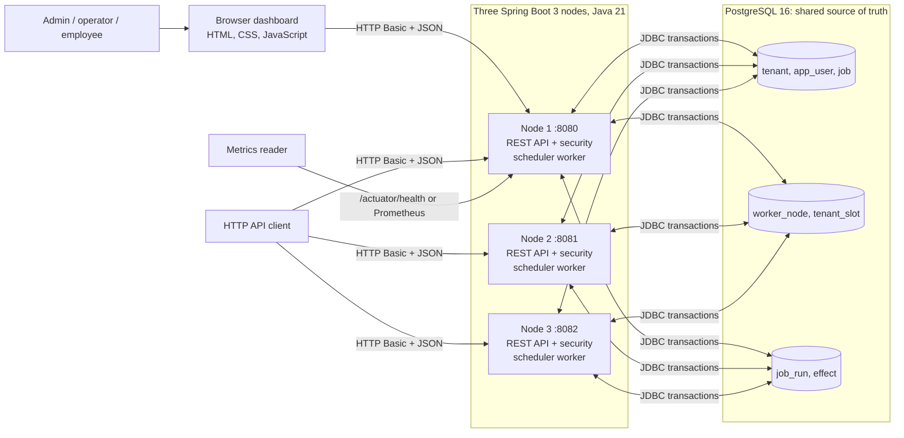
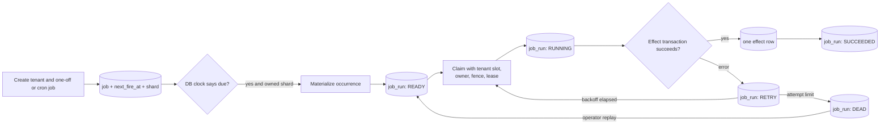
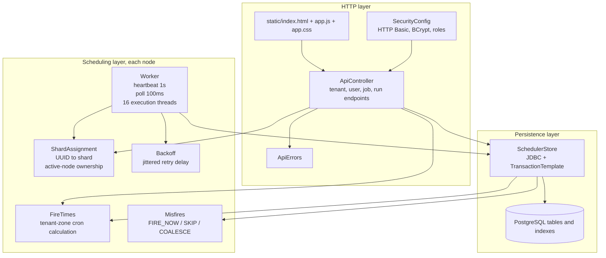
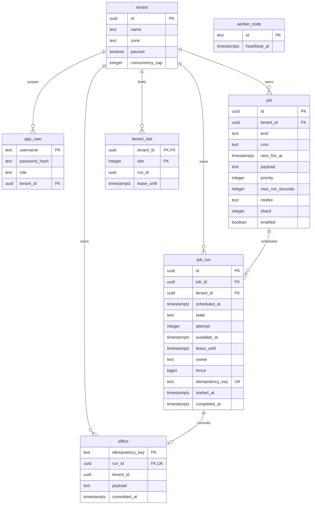
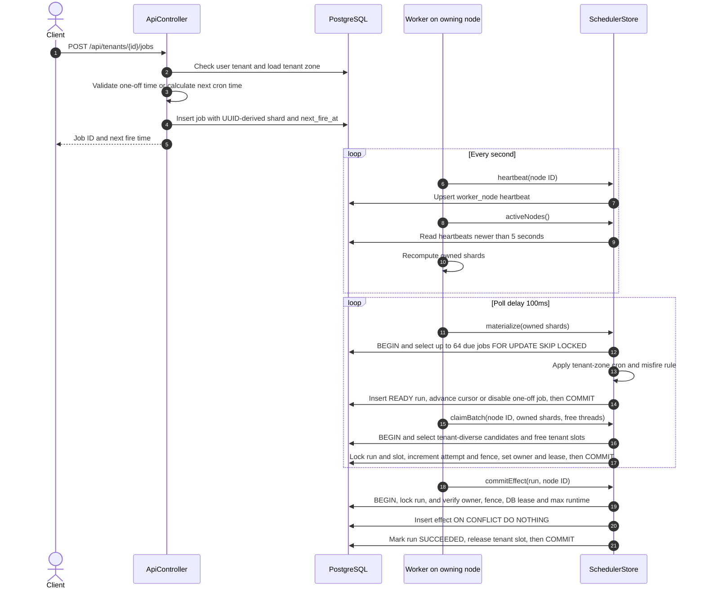
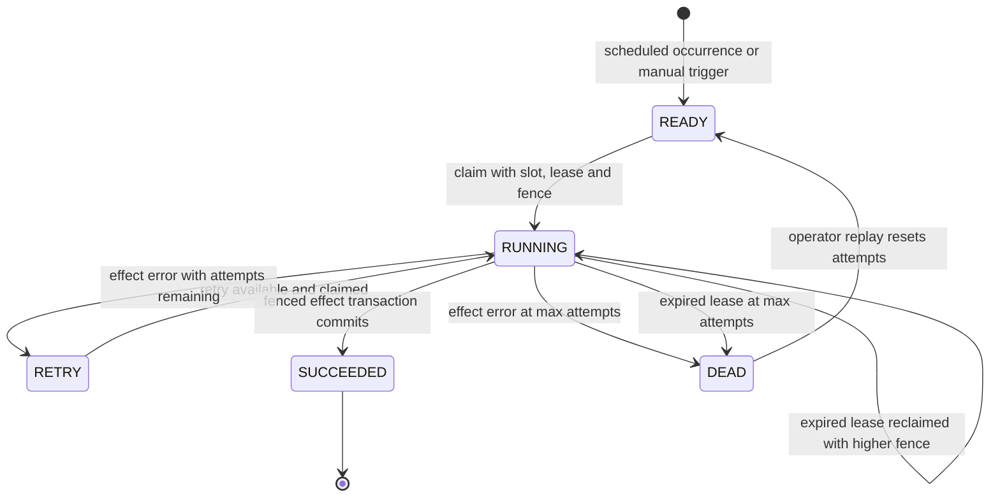
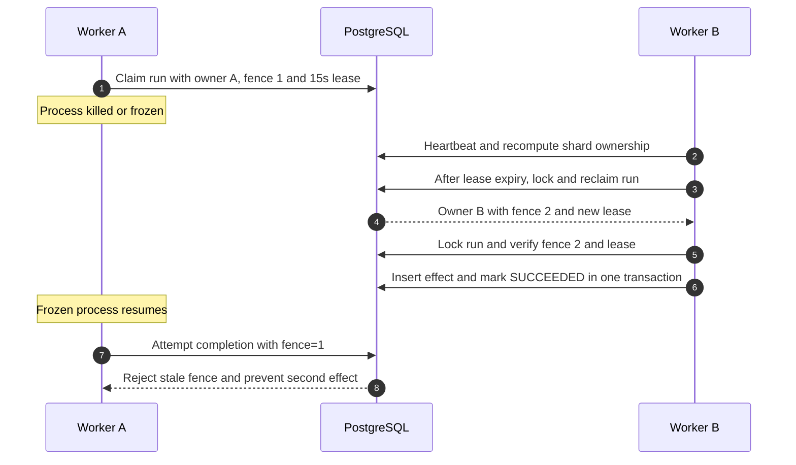

# Trip job scheduler: HLD and LLD

These diagrams describe the code in this repository. They show the local three-node deployment from `compose.yaml`; production networking and an external notification provider are outside this implementation.

## High-level design (HLD)

### System and deployment

All three nodes run the same application and can serve the API and dashboard. The example browser URL is node 1. Each worker writes a heartbeat to `worker_node` every second. A node is active if its heartbeat is less than five seconds old. The sorted active node IDs divide **256 logical shards** by `shard % activeNodeCount`; the job UUID determines its shard. Membership changes redistribute ownership without moving job rows. PostgreSQL is required for the API, coordination, and execution.

The dashboard is served from Spring Boot's static resources. It calls the authenticated REST API and refreshes its data every 15 seconds. There is no separate frontend service or message broker. The `effect` table is the local demonstration side effect; this code does not call a cab alert service.

### End-to-end data flow

The database clock (`clock_timestamp()`) decides when jobs are due, retries are available, and leases expire. The application clock drives polling and logs. The guarantees are **at-least-once attempts** and **one committed local effect per run**. A process may execute the attempt more than once after a crash or expired lease. An external provider needs the same idempotency key or a transactional outbox and downstream deduplication.

## Low-level design (LLD)

### Code modules and calls

`ApiController` checks the authenticated user's tenant before tenant operations; admins can access all tenants, operators can write within their own tenant, and employees have read access. Spring Security restricts `/api/admin/**` to admins and `/actuator/**` to admins except health. The worker and API use the same `SchedulerStore` on each node.

### Database relationships

`worker_node` is intentionally separate from the business-data relationships. Its rows represent heartbeats, not foreign-key ownership. An admin user may have a null `tenant_id`; operator and employee users are tenant-scoped by the API. Important constraints are `UNIQUE(job_id, scheduled_at)` on `job_run`, unique `job_run.idempotency_key`, and `effect.idempotency_key` as the primary key. `tenant_slot` has one row per allowed concurrent run. The partial `job_due_idx` supports enabled jobs by shard and due time; `job_run_claim_idx` and `job_run_tenant_queue_idx` support active run selection.

### Create, materialize, claim, commit

Materialization and claim are separate transactions. The first transaction makes a scheduled occurrence durable, while the second reserves capacity to execute it. Each poll materializes at most 64 jobs; each claim operation considers at most 64 candidate rows and fills at most the available execution threads. Candidate selection starts with one earliest eligible run per tenant, then takes at most eight runs from a selected tenant in that claim transaction. The pool has 16 threads per node; three nodes provide up to 48 simultaneous attempts, subject to tenant slot caps.

For recurring jobs, `next_fire_at` is advanced in the materialization transaction. The worker evaluates at most 500 missed occurrences per job in one pass. A run more than two seconds late follows its `FIRE_NOW`, `SKIP`, or `COALESCE` policy. Manual trigger bypasses the due-job scan and inserts a `READY` run directly.

### Run state transitions and recovery

`available_at` gates retries. `Backoff` uses exponential delay with jitter and a five-minute cap. The configured maximum is five attempts and the lease lasts 15 seconds. A renewal task extends a live lease every five seconds while the worker is executing. A paused tenant is excluded from new materialization and claims; already running attempts may complete.

### Crash or freeze after a claim

The database row lock serializes competing completion attempts. The fence and lease check happen before the effect write, inside the same transaction as run completion. A node kill can require the five-second membership window for shard takeover and up to the 15-second run lease for a claimed run. Exactly-once *execution* is not promised; exactly one committed local effect is enforced. External effects require idempotency beyond this database.

### Capacity and verification

| Parameter | Current value | Source / purpose |
| --- | ---: | --- |
| Worker nodes in Compose | 3 | Same application image, one PostgreSQL instance |
| Logical shards | 256 | `app.shards`; partition due jobs and claims |
| Worker heartbeat / active window | 1 s / 5 s | Membership and shard assignment |
| Poll delay | 100 ms | Look for due jobs and available runs |
| Execution threads | 16 per node | Up to 48 across three nodes |
| Tenant concurrency | 1–128, benchmark uses 8 | `tenant_slot` rows |
| Claim lease / renewal | 15 s / 5 s | Takeover and live attempt protection |
| Max attempts | 5 | Retry then dead letter |
| Due jobs per materialization | 64 | Bounded database transaction |
| Measured case-study load | 100,000 jobs / 10 min / 3 nodes | 0.694 s p99 fire lag on the documented local machine |

The measured workload used 100 tenants with 1,000 jobs each, due uniformly over ten minutes. It created 100,000 `job_run` rows and 100,000 committed `effect` rows, with no dead runs. See [README.md](README.md#tests-and-benchmark) and [scripts/benchmark-100k.sh](scripts/benchmark-100k.sh) for the reproducible setup and measurement limits.
