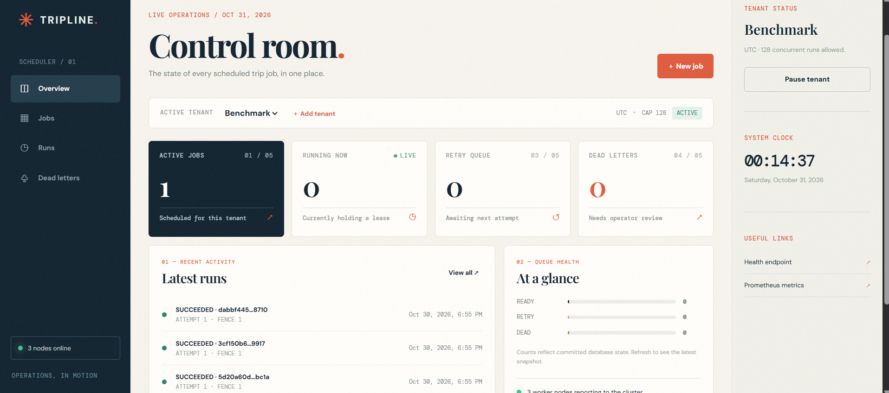
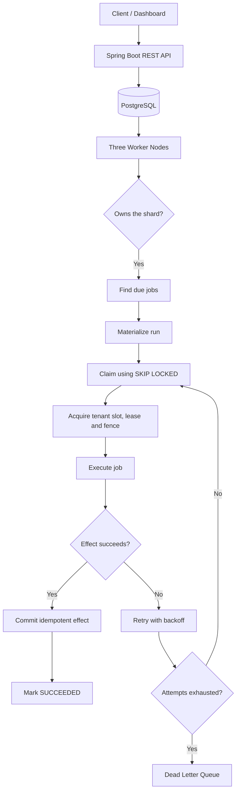

# Distributed Trip Job Scheduler


A Java 21, Spring Boot, and PostgreSQL backend for scheduling one-off and recurring jobs across three worker nodes. It supports tenant time zones, sharded work assignment, fenced leases, retries, tenant concurrency limits, and an idempotent database effect ledger.

**This repository includes a REST API and a web-based operations dashboard. Open http://localhost:8080/ after starting the application.** The steps below use `curl` to demonstrate the API. See [DESIGN.md](DESIGN.md) for the architecture, failure handling, guarantees, and trade-offs.

## Prerequisites

- Docker Engine and Docker Compose (`docker compose version`)
- A Bash shell, `curl`, and Python 3 for the copyable example commands
- Ports **8080**, **8081**, **8082**, and **5432** available on your machine

You do not need to install Java, Maven, or PostgreSQL for the Docker setup. Run all commands from the project directory.

## Web Dashboard

The project includes a browser-based operations dashboard.

After starting the application, open:

- Node 1: http://localhost:8080/
- Node 2: http://localhost:8081/
- Node 3: http://localhost:8082/

Log in using the admin username and password configured during startup.

The dashboard supports:
- Tenant overview and management.
- Job creation and scheduling.
- Manual job triggering.
- Execution history and run inspection.
- Dead-letter inspection.
- Tenant pause and resume controls.
- Monitoring the three worker nodes.

## Dashboard Screenshots

### Login Page


### Dashboard Overview



## How the Scheduler Works

The following diagram illustrates the complete lifecycle of a scheduled job, from API creation and shard-based materialization to execution, idempotent effects, and failure recovery.



## Key Engineering Highlights

| Challenge | Implementation |
|---|---|
| Distributed coordination | 256 logical shards across three worker nodes |
| Concurrent job claiming | PostgreSQL `FOR UPDATE SKIP LOCKED` |
| Stale worker protection | Time-limited leases and fencing tokens |
| Duplicate effect prevention | Idempotency keys and transactional effect ledger |
| Tenant concurrency | Database-backed concurrency slots |
| Failure recovery | Exponential backoff, retries, and Dead Letter Queue |
| Scheduling correctness | IANA time zones and DST-aware cron scheduling |
| Misfire handling | FIRE_NOW, SKIP, and COALESCE policies |
| Operational control | Tenant pause/resume and manual job triggering |

## Start the project

```bash
read -rsp 'Choose an admin password: ' ADMIN_PASSWORD; echo
export ADMIN_PASSWORD
APP_BOOTSTRAP_ADMIN_PASSWORD="$ADMIN_PASSWORD" docker compose up --build -d
docker compose ps
curl -fsS http://localhost:8080/actuator/health
```

The first build downloads the Java and PostgreSQL images and Maven dependencies, so it can take a few minutes. When ready, the health request returns `{"status":"UP"}`. Node 1 serves the examples at `http://localhost:8080`; nodes 2 and 3 serve the same API on ports 8081 and 8082. All three share one PostgreSQL database.

The first startup creates the HTTP Basic user `admin` with `ADMIN_PASSWORD`. The password is stored as a BCrypt hash. **Changing the environment variable later does not change the password of an existing admin account.** Keep the password out of screenshots. Use HTTPS in front of the API before exposing it outside your machine.

## Try the API

The following commands create a tenant, schedule a recurring job, trigger it immediately, and inspect its run. Keep `ADMIN_PASSWORD` from the startup step in the same shell.

### 1. Create a tenant

```bash
BASE=http://localhost:8080
TENANT=$(curl -fsS -u "admin:$ADMIN_PASSWORD" \
  -H 'Content-Type: application/json' \
  -d '{"name":"Demo client","zone":"Asia/Kolkata","concurrencyCap":8}' \
  "$BASE/api/admin/tenants" |
  python3 -c 'import json,sys; print(json.load(sys.stdin)["id"])')
echo "$TENANT"
```

`zone` is an IANA time zone. `concurrencyCap` limits how many runs this tenant can execute at once (1 to 128).

### 2. Create a recurring job

```bash
JOB=$(curl -fsS -u "admin:$ADMIN_PASSWORD" \
  -H 'Content-Type: application/json' \
  -d '{"kind":"CRON","cron":"0 0 22 * * *","payload":"roster-generation","priority":1,"maxRunSeconds":60,"misfire":"COALESCE"}' \
  "$BASE/api/tenants/$TENANT/jobs" |
  python3 -c 'import json,sys; print(json.load(sys.stdin)["id"])')
echo "$JOB"
curl -fsS -u "admin:$ADMIN_PASSWORD" "$BASE/api/tenants/$TENANT/jobs/$JOB/next?count=5"
```

The six-field cron expression above schedules 10:00 PM every day in the tenant's time zone. `misfire` can be `FIRE_NOW`, `SKIP`, or `COALESCE`. A one-off job uses `"kind":"ONE_OFF"` and an ISO-8601 timestamp such as `"at":"2030-01-01T16:30:00Z"` instead of `cron`.

### 3. Trigger and inspect a run

```bash
RUN=$(curl -fsS -u "admin:$ADMIN_PASSWORD" -X POST \
  "$BASE/api/tenants/$TENANT/jobs/$JOB/trigger" |
  python3 -c 'import json,sys; print(json.load(sys.stdin)["runId"])')
echo "$RUN"
curl -fsS -u "admin:$ADMIN_PASSWORD" "$BASE/api/tenants/$TENANT/runs/$RUN"
curl -fsS -u "admin:$ADMIN_PASSWORD" "$BASE/api/tenants/$TENANT/runs/$RUN/effects"
```

The run state moves from `READY` to `RUNNING` to `SUCCEEDED`; the last request then returns `{"count":1}`. If it is still processing, wait a second and repeat the two `GET` requests.

**The effect is a row in PostgreSQL's `effect` table.** This demo does not send real cab alerts or call another provider. A real provider must deduplicate the run's idempotency key to preserve the exactly-once effect guarantee outside this database.

## Other useful requests

The examples below use the `BASE` and `TENANT` values created above.

| Action | Request |
| --- | --- |
| Pause a tenant | `curl -u "admin:$ADMIN_PASSWORD" -X POST "$BASE/api/tenants/$TENANT/pause"` |
| Resume a tenant | `curl -u "admin:$ADMIN_PASSWORD" -X POST "$BASE/api/tenants/$TENANT/resume"` |
| List dead-letter runs | `curl -u "admin:$ADMIN_PASSWORD" "$BASE/api/tenants/$TENANT/dead"` |
| Replay a dead-letter run | `curl -u "admin:$ADMIN_PASSWORD" -X POST "$BASE/api/tenants/$TENANT/dead/RUN_ID/replay"` |
| Health check | `curl "$BASE/actuator/health"` |
| Prometheus metrics | `curl -u "admin:$ADMIN_PASSWORD" "$BASE/actuator/prometheus"` |

To create a tenant-scoped operator or employee, an admin can call `POST /api/admin/users`:

```bash
curl -fsS -u "admin:$ADMIN_PASSWORD" -H 'Content-Type: application/json' \
  -d "{\"username\":\"demo-operator\",\"password\":\"replace-with-12-plus-characters\",\"role\":\"OPERATOR\",\"tenantId\":\"$TENANT\"}" \
  "$BASE/api/admin/users"
```

`ADMIN` can manage all tenants. `OPERATOR` can manage jobs and dead letters for its tenant. `EMPLOYEE` can read its tenant's next fire times and run status. Cross-tenant requests return 404.

## Tests and benchmark

Run the unit and PostgreSQL integration tests with:

```bash
bash scripts/test.sh
```

The script starts a separate test database on port **55432** and runs Maven in a Docker container. The suite covers daylight-saving transitions, shard redistribution, concurrent claims, stale fencing tokens, tenant limits, retries, dead-letter replay, and tenant isolation. The last verified run had **7 passing tests**.

With the application running, you can measure a scheduler-only burst:

```bash
APP_BOOTSTRAP_ADMIN_PASSWORD="$ADMIN_PASSWORD" bash scripts/benchmark.sh 1000
```

This benchmark inserts ready runs directly into PostgreSQL, excluding API creation time.

#### Three-node, 100,000-run benchmark

A 100,000-run benchmark was completed across three worker nodes.

| Metric | Observed result |
|---|---:|
| Runs completed | 100,000 |
| Execution window (first start to last completion) | 837.31 seconds |
| Average effect execution time | 9.1 ms |
| p99 fire lag | 1,454.634 seconds |
| Target execution window | 600 seconds |
| Target p99 fire lag | Below 2 seconds |

**Performance status:** All 100,000 runs completed successfully, but the measured execution window and p99 fire lag did not meet the case study targets.

The execution window measures from the first run's start to the last run's completion. It is not the full benchmark wall-clock duration.

The p99 fire lag is calculated using the difference between each run's start time and scheduled time.

These measurements are from a development environment and should not be treated as production performance guarantees.

## Stop and troubleshoot

```bash
docker compose logs -f node1
docker compose stop
```

`docker compose stop` preserves the containers and their database contents for the next `docker compose start`. **`docker compose down` removes the PostgreSQL container and its data**, because this demo does not configure a persistent volume.

If startup fails, check `docker compose ps` and `docker compose logs postgres node1`. Port conflicts are common; free ports 5432 and 8080-8082 before retrying. If authentication fails after changing `ADMIN_PASSWORD`, remember that an existing database still has the password from its first startup.

## Project Demo

Watch the complete project walkthrough, covering the dashboard,
job scheduling, execution flow, and operational controls.

▶️ **[Watch Demo Video](https://1drv.ms/v/c/5c5ed2f461fa0214/IQDDzer6FDuOSpNmISESpk8CATuRkX4-gJjn7fJTckxPjOY?e=5GnkjP)**